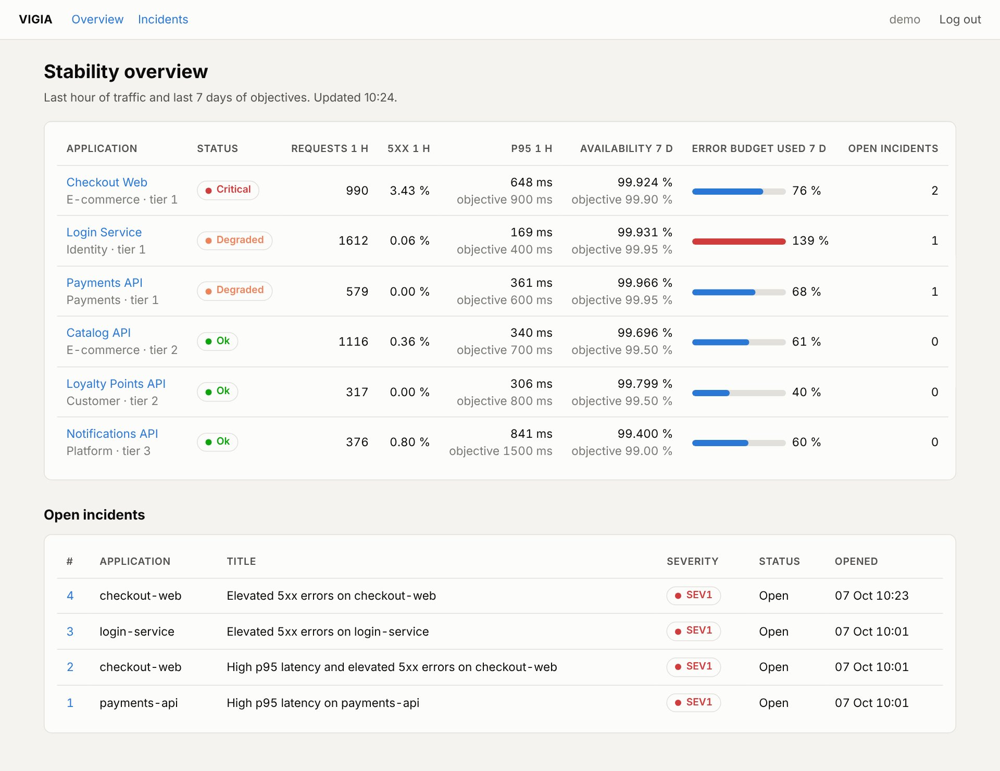
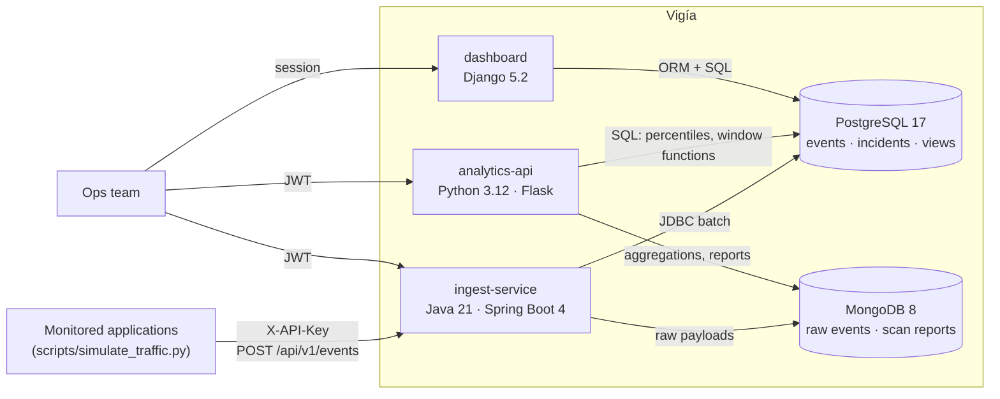

# Vigía · operational stability monitoring

[](https://github.com/lobby9000/vigia/actions/workflows/ci.yml)

Vigía (Spanish for *lookout*) watches the applications of an organisation that
serves millions of customers and answers the questions an operations team asks
every day: **is anything degrading right now, are we meeting our service level
objectives, and when something breaks, where is it coming from?**

It is a small but complete polyglot platform:

* a **Java / Spring Boot** service that ingests request telemetry from every application,
* a **Python / Flask** API that turns it into SLO reports and detects anomalies with **pandas, NumPy and SciPy**,
* a **Django** back-office for the people who manage incidents,
* **PostgreSQL** as the source of truth and **MongoDB** for raw, schemaless payloads,
* Bash tooling, Docker Compose, GitHub Actions CI and a documented path to **AWS**.



## What it does

* **Ingests telemetry** in batches through a REST API protected by per-application API keys
  (`POST /api/v1/events`, Spring Boot, JDBC batch inserts).
* **Stores it twice, on purpose**: typed columns in PostgreSQL for analytics, the full payload
  (app version, client...) in MongoDB with a 7-day TTL.
* **Computes SLO compliance** (availability, p95 latency, error budget) from a materialized view.
* **Detects anomalies statistically**: robust z-scores (median and MAD) for latency, exact binomial
  tail probabilities for error counts, and a persistence rule against one-bucket noise. Each
  detection becomes an incident in PostgreSQL and a detailed report in MongoDB.
* **Explains incidents**: a MongoDB aggregation breaks errors down by release and region
  ("version 3.2.0 fails 40 % of its requests, 3.1.4 is fine").
* **Manages incidents** in a Django back-office with role-based access.

The thresholds were calibrated by simulation (`make calibrate`): over 40 synthetic runs of 10 days
(2 400 application-days, 120 injected incidents and 40 failing releases) the detector missed
nothing and raised a single false alarm.

## Architecture



The analytics API issues JWTs (HS256); the ingest service validates the same tokens as an OAuth2
resource server, so one login works across both APIs. Details and trade-offs:
[docs/architecture.md](docs/architecture.md).

## Tech stack

| Area | Technology | Where |
|---|---|---|
| Java service | Java 21, Spring Boot 4.1, Spring MVC, Spring Data JPA (Hibernate 7), JdbcTemplate, Spring Data MongoDB, Spring Security (API key + JWT resource server), Bean Validation, springdoc OpenAPI, JUnit, Mockito, MockMvc | `ingest-service/` |
| Python API | Flask 3, flask-smorest (OpenAPI + Swagger UI), marshmallow, flask-jwt-extended, SQLAlchemy Core, pandas, NumPy, SciPy, PyMongo, pytest | `analytics-api/` |
| Web back-office | Django 5.2 LTS, Django admin, ORM over an existing schema, raw SQL, Chart.js | `dashboard/` |
| Relational | PostgreSQL 17: constraints, covering, partial and BRIN indexes, views, materialized view, window functions, ranges | `database/` |
| Non-relational | MongoDB 8: TTL and compound indexes, aggregation pipeline; Cassandra design notes | [docs/cassandra-design.md](docs/cassandra-design.md) |
| UNIX | Bash scripts (bootstrap, cron jobs, backups with retention, awk reports), Makefile | `scripts/` |
| Delivery | Docker multi-stage builds, Docker Compose, GitHub Actions | root, `.github/` |
| Cloud | AWS deployment guide (EC2 or ECR + ECS Express Mode + RDS) | [docs/deploy-aws.md](docs/deploy-aws.md) |

## Quick start

Requirements: Docker Engine with the Compose plugin, Python 3.12, `curl`, `openssl`.
Java 21 and Maven are only needed to work on the Java service outside Docker.

```bash
git clone https://github.com/lobby9000/vigia.git && cd vigia
./scripts/bootstrap.sh                 # .env with random secrets, builds and starts everything, creates users

python3 -m venv .venv && source .venv/bin/activate
pip install -r scripts/requirements.txt
make seed                              # 10 days of history up to an hour ago (about 1.4 M requests) into PostgreSQL
make simulate                          # the last hour through the Java API, with a failing canary release
make scan                              # run the anomaly detector on every application
```

| What | URL | Login |
|---|---|---|
| Dashboard and admin | http://localhost:8001 | `admin` / `VIGIA_ADMIN_PASSWORD` from `.env` |
| Analytics API, Swagger UI | http://localhost:8000/docs | `admin` or `viewer` |
| Ingest service, Swagger UI | http://localhost:8080/swagger-ui.html | JWT from the analytics API |

`make` lists every shortcut (`make logs`, `make psql`, `make backup`, `make test`...).

## A short tour with curl

```bash
# 1. Log in (the token works on both APIs)
TOKEN=$(curl -s -X POST localhost:8000/api/v1/auth/login -H 'Content-Type: application/json' \
  -d "{\"username\":\"admin\",\"password\":\"$VIGIA_ADMIN_PASSWORD\"}" | python3 -c 'import json,sys;print(json.load(sys.stdin)["accessToken"])')

# 2. Which applications are burning their error budget?
curl -s -H "Authorization: Bearer $TOKEN" 'localhost:8000/api/v1/reports/slo?days=7'

# 3. Scan checkout-web for anomalies: opens incidents, stores the report in MongoDB
curl -s -X POST -H "Authorization: Bearer $TOKEN" -H 'Content-Type: application/json' \
  -d '{"hours": 24, "bucketMinutes": 15}' localhost:8000/api/v1/applications/checkout-web/anomaly-scans

# 4. Which release is failing? (MongoDB aggregation over raw events)
curl -s -H "Authorization: Bearer $TOKEN" 'localhost:8000/api/v1/applications/checkout-web/error-breakdown?minutes=60'

# 5. Acknowledge the incident
curl -s -X PATCH -H "Authorization: Bearer $TOKEN" -H 'Content-Type: application/json' \
  -d '{"status": "ACKNOWLEDGED"}' localhost:8000/api/v1/incidents/1

# 6. Register a new application in the Java service (the API key is shown once)
curl -s -X POST -H "Authorization: Bearer $TOKEN" -H 'Content-Type: application/json' \
  -d '{"code":"fraud-api","name":"Fraud API","team":"Risk","tier":1,"sloAvailability":0.999,"sloLatencyP95Ms":300}' \
  localhost:8080/api/v1/applications
```

The full endpoint list is in [docs/api.md](docs/api.md).

## Project structure

```
vigia/
├── database/            PostgreSQL schema, views, seed data and SQL examples
├── ingest-service/      Spring Boot service: ingestion, application registry, security
├── analytics-api/       Flask API: SLOs, anomaly detection, incidents, error breakdown
├── dashboard/           Django back-office: overview, per-application charts, admin
├── scripts/             data generator, traffic simulator, Bash tooling
├── docs/                architecture, database, API, AWS deployment, Cassandra notes
├── docker-compose.yml   the whole platform on one machine
└── Makefile             everyday shortcuts
```

## Tests

| Suite | Command | What it covers |
|---|---|---|
| Analytics API | `make test-python` | 39 tests: detector unit tests on synthetic series, auth and roles, every endpoint against a real PostgreSQL, MongoDB through mongomock |
| Dashboard | `make test-django` | 11 tests on a throwaway database built from the same SQL files |
| Ingest service | `make test-java` | 19 tests: services with Mockito, controllers and security with MockMvc, real HS256 tokens |
| Scripts | `make lint` | shellcheck and ruff |
| Detector calibration | `make calibrate` | 10 simulated runs: missed incidents and false alarms per threshold. In CI it fails the build if the default threshold misses anything |

GitHub Actions runs all of them, with PostgreSQL as a service container, on every push.

## Design decisions

* **Each store does what it is best at.** PostgreSQL holds the typed, relational truth;
  MongoDB holds variable payloads and nested reports. [Why, and what it costs](docs/architecture.md).
* **The schema is owned by SQL files, not by an ORM.** Three services in two languages share it;
  Hibernate and Django only map it (`ddl-auto: none`, `managed = False`).
* **Statistics with a reason.** Robust estimators for latency, exact binomial tails for counts,
  practical-significance thresholds and persistence, with every default calibrated by a Monte Carlo
  study (`scripts/calibrate_detector.py`). [docs/architecture.md#anomaly-detection](docs/architecture.md#anomaly-detection).
* **Security by default.** Deny-by-default authorization, API keys stored as hashes, salted
  password hashing, constant-time login answers, secrets only in environment variables.

## Roadmap

* Transactional outbox so the PostgreSQL and MongoDB writes can never diverge.
* Flyway or Alembic migrations instead of init scripts.
* Monthly partitioning of `request_events` (or TimescaleDB) beyond a few hundred million rows.
* Kafka between ingestion and storage for traffic peaks.
* Seasonal baselines (same hour last week) for slowly varying metrics.

## How this was built

I built Vigía with an AI assistant (Claude) to learn a polyglot stack end to end. The figures in this README come from the test suites and the calibration script in the repository.

## Licence

MIT. See [LICENSE](LICENSE).

---

Part of the portfolio of Luis Ángel Quiroz López · [lobby9000.github.io](https://lobby9000.github.io) · [LinkedIn](https://www.linkedin.com/in/llqq) · [GitHub](https://github.com/lobby9000)
