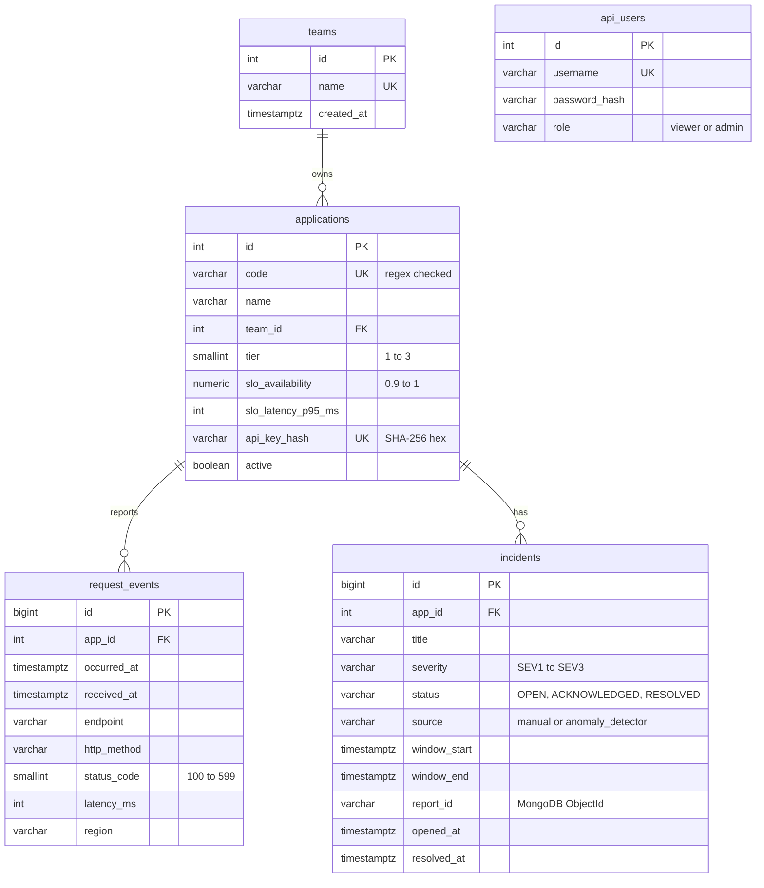

# Database design

## Entity-relationship diagram

Files, executed in order by the Postgres container on its first start:

| File | Content |
|---|---|
| `01_schema.sql` | Tables, constraints, indexes |
| `02_views.sql` | `mv_app_daily_stats` (materialized), `v_app_status_last_hour`, `v_open_incidents` |
| `03_seed_reference.sql` | Teams and six demo applications with development API keys |
| `queries/analysis_examples.sql` | Hand-run examples: joins, percentiles, window functions, EXPLAIN |

## Constraints as business rules

* `CHECK (code ~ '^[a-z0-9][a-z0-9-]{2,49}$')`: application codes are URL-safe.
* `CHECK (status_code BETWEEN 100 AND 599)`, `CHECK (latency_ms >= 0)`: no impossible telemetry.
* `CHECK ((status = 'RESOLVED') = (resolved_at IS NOT NULL))`: a resolved incident always has a
  resolution time and only resolved ones do. Java, Python and Django all get this guarantee.
* Foreign keys everywhere, and an explicit index on `applications.team_id`: PostgreSQL does not
  index foreign keys by itself.

## Indexes on `request_events`

Measured on the demo data (1.4 million rows):

| Index | Type | Size | Serves |
|---|---|---|---|
| `idx_events_app_time` | B-tree `(app_id, occurred_at) INCLUDE (status_code, latency_ms)` | 93 MB | One application over a time range. Covering: after `VACUUM`, health queries run as **Index Only Scans** with zero heap fetches |
| `idx_events_app_errors` | Partial B-tree `WHERE status_code >= 500` | 120 kB | "Latest errors of app X": indexes only the 0.16 % of rows that matter |
| `idx_events_occurred_brin` | BRIN on `occurred_at` | 24 kB | All applications, recent time window. Works because rows are inserted in time order |
| `request_events_pkey` | B-tree on `id` | 30 MB | Primary key |

The BRIN index is about 4 000 times smaller than the B-tree. Its condition: the physical order of
the table must follow the indexed column, which is why the generator interleaves all applications
in time order before loading each day.

Try it: `database/queries/analysis_examples.sql`, section 5, prints the three plans.

## Views

* **`mv_app_daily_stats`** (materialized): requests, 5xx, 4xx, average and p95 latency per
  application and day. Refreshed with `REFRESH MATERIALIZED VIEW CONCURRENTLY`, which needs the unique
  index `(app_id, day)` and keeps the view readable during the refresh. Percentiles cannot be
  re-aggregated (the weekly p95 is not the average of daily p95 values), so consumers only sum counts.
* **`v_app_status_last_hour`**: live status, `LEFT JOIN` so silent applications appear with zero
  requests (silence is a signal too).
* **`v_open_incidents`**: incidents with their application and team, plus minutes open.

## Query patterns used by the code

| Pattern | Example | File |
|---|---|---|
| Time bucketing | `date_bin(interval '15 minutes', occurred_at, TIMESTAMPTZ '2000-01-01')` | `analytics-api/vigia_analytics/repository.py` |
| Conditional aggregation | `COUNT(*) FILTER (WHERE status_code >= 500)` | everywhere |
| Ordered-set aggregate | `percentile_cont(0.95) WITHIN GROUP (ORDER BY latency_ms)` | repository, views |
| CTE + window function | SLO report ranked with `RANK() OVER (ORDER BY ...)` | `repository.py` (`_SLO_REPORT`) |
| Total count with pagination | `COUNT(*) OVER ()` next to `LIMIT/OFFSET` | `repository.py` (`_LIST_INCIDENTS`) |
| Optional filters, still parameterised | `(CAST(:status AS text) IS NULL OR status = :status)` | `repository.py` |
| Range overlap | `tstzrange(a, b, '[]') && tstzrange(c, d, '[]')` to avoid duplicate incidents | `repository.py` |
| Row locking | `SELECT ... FOR UPDATE` before a status transition | `repository.py` |
| Bulk load | `COPY ... FROM STDIN` (40 000+ rows/s) | `scripts/generate_history.py` |

## MySQL equivalents (for interviews)

| PostgreSQL | MySQL 8 |
|---|---|
| `GENERATED ... AS IDENTITY` | `AUTO_INCREMENT` |
| `TIMESTAMPTZ` | `TIMESTAMP` (stored in UTC) or `DATETIME` |
| `COUNT(*) FILTER (WHERE c)` | `SUM(CASE WHEN c THEN 1 ELSE 0 END)` |
| `percentile_cont` | No built-in: window functions (`PERCENT_RANK`, `NTILE`) or computed in the application |
| Partial index | Not available (functional indexes since 8.0.13 cover some cases) |
| BRIN | Not available; InnoDB tables are clustered by primary key |
| Materialized view | Not available: summary table refreshed by an event or a job |
| `date_bin` | `FROM_UNIXTIME(FLOOR(UNIX_TIMESTAMP(ts) / 900) * 900)` |
